

  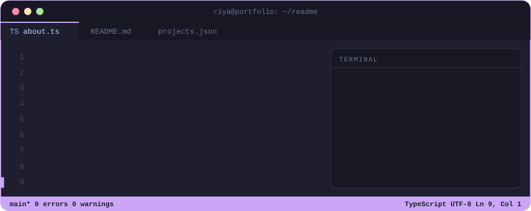

 

  
  
  
  
  

 

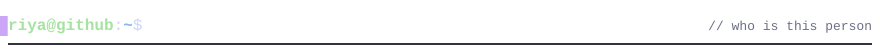

- 🎓 **AI & ML student** building practical, real-world applications, not just notebooks
- 🌐 **Full-stack** across the MERN stack, with real-time features, maps, dashboards and computer vision
- 🛠️ **Backend fundamentals**: REST APIs, databases, auth, queues, observability
- ☕ **Java** for core programming and DSA, **Python** for ML and scripting
- 🚀 Currently shipping projects that mix **AI + product thinking**

 

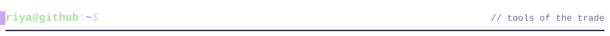

  

  <code>Pandas</code> · <code>NumPy</code> · <code>XGBoost</code> · <code>Streamlit</code> · <code>MediaPipe</code> · <code>Socket.IO</code> · <code>Zustand</code> · <code>Recharts</code> · <code>Mapbox GL JS</code>

 

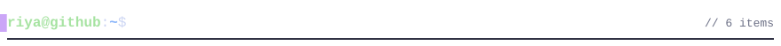

<a href="https://github.com/riyahref/f1-race-strategy-ai">
  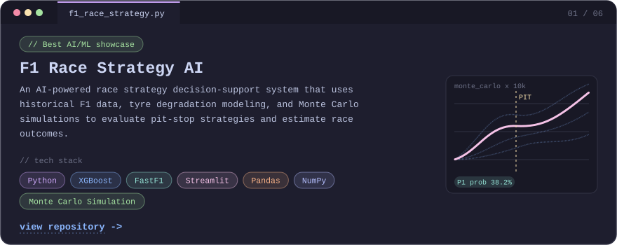
</a>

<a href="https://github.com/riyahref/sentinel">
  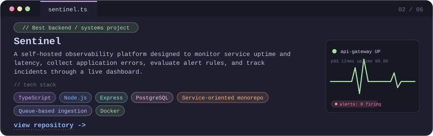
</a>

<a href="https://github.com/riyahref/safe-route-recommendation">
  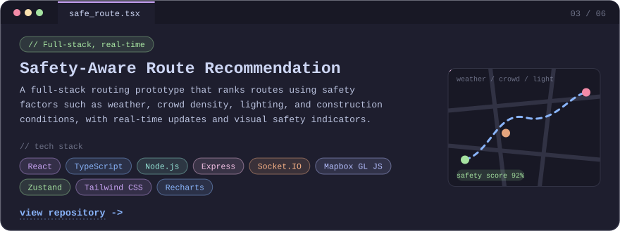
</a>

<a href="https://github.com/riyahref/subreddit-vibe-check">
  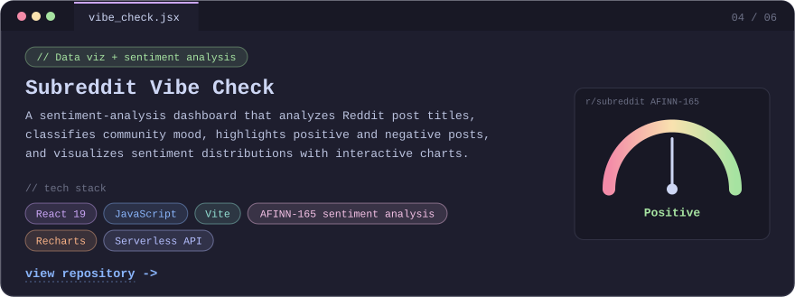
</a>

<a href="https://github.com/riyahref/newphotobooth">
  
</a>

<a href="https://github.com/riyahref/AI-canvas">
  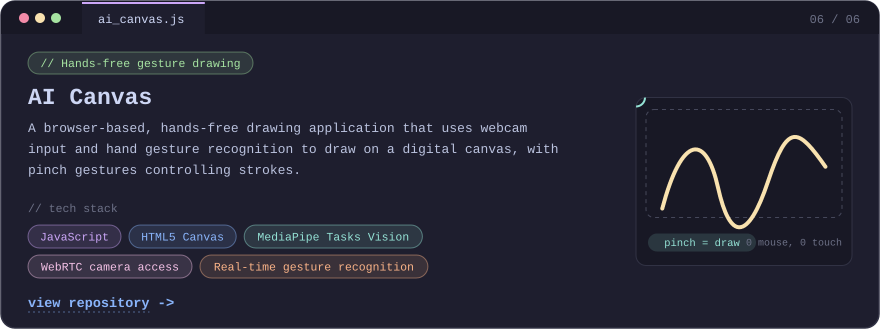
</a>

  <a href="https://github.com/riyahref?tab=repositories"><code>$ git ls-remote --all  ->  more repos</code></a>

 

<table width="100%">
  <tr>
    <td width="50%" align="center">
      
    </td>
    <td width="50%" align="center">
      
    </td>
  </tr>
</table>

  

  

 

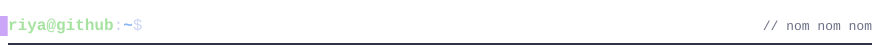

  

 

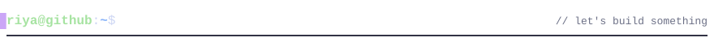

  
  
  
    
  

